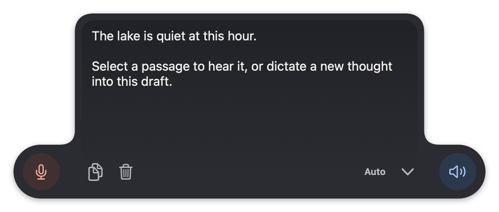

# Amapoani

Amapoani is a keyboard-first read-aloud and dictation capsule for Apple Silicon Macs. It reads selected text or a draft with Kokoro and transcribes speech with Whisper. English and Spanish work offline after speech setup.

## Get started

1. Download **Amapoani-macos-arm64.dmg** from the [current beta release](https://github.com/xochilcahua/Amapoani-Beta/releases).
2. Open the disk image, drag **Amapoani** into **Applications**, then open the installed copy.
3. In **Models**, choose **Set Up Speech**. Setup downloads the verified runtime and any missing models. Existing compatible models can be reused.

This beta requires an Apple Silicon Mac with macOS 14 or later. It is ad hoc signed and has no Apple notarization. If Apple blocks the first open, see the [first-launch guide](docs/setup.md#approve-the-first-launch).

Press **Option–Shift–Space** to summon the capsule. In **Settings → Shortcuts**, turn on **Show or hide with the microphone key** to use the built-in microphone key instead.

## Documentation

| Guide | What it covers |
| --- | --- |
| [Install and set up](docs/setup.md) | Disk image, first launch, speech models, browser permissions, updates and removal |
| [Using Amapoani](docs/guide.md) | Reading, dictation, transcript review, shortcuts and all Settings tabs |
| [Microphone key](docs/microphone-key.md) | Automatic setup, ready and error states, and legacy remaps |
| [Build and test](docs/build.md) | Source builds, disk images and regression checks |
| [Architecture](docs/architecture.md) | AppKit, Rust session state, speech workers and desktop integration |

## License

[Apache 2.0](LICENSE) covers the source. The Amapoani name and artwork are reserved under the [brand terms](BRAND.md). The speech engines and models retain their [upstream licenses](THIRD_PARTY.md).
