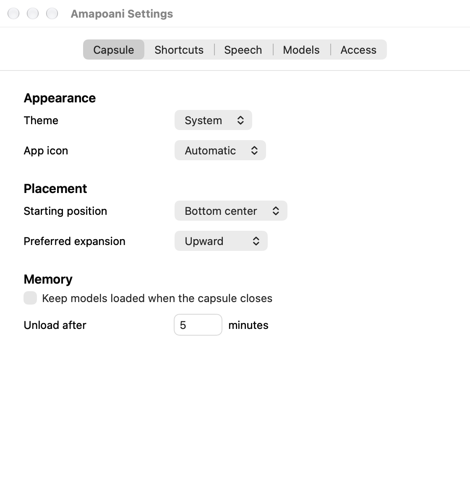
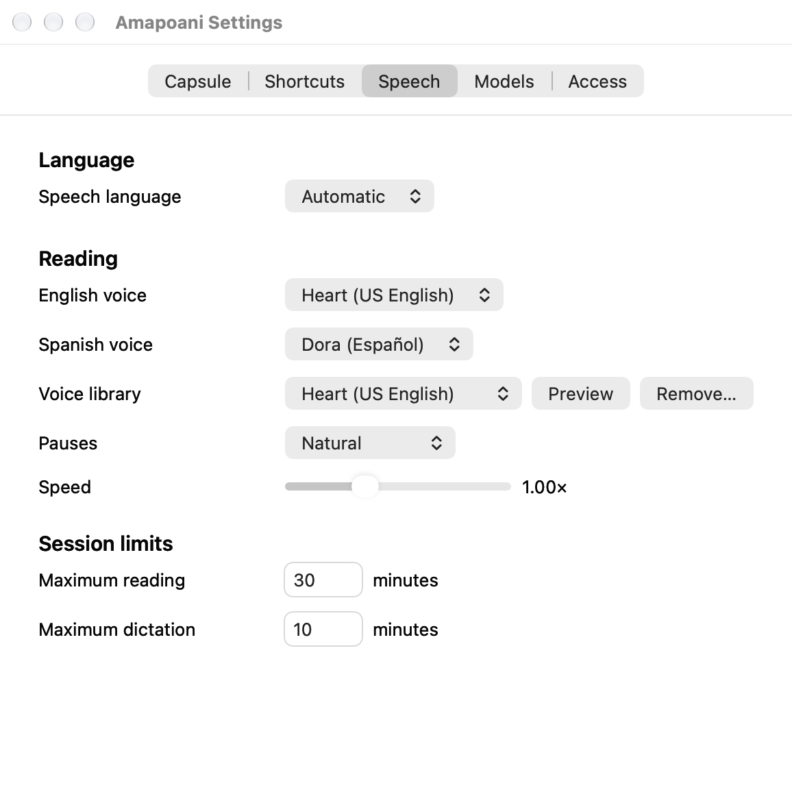

# Using Amapoani

Open the capsule with **Option–Shift–Space**, or choose **Show Capsule** from its menu-bar icon. Once you enable the built-in [microphone key](microphone-key.md), it can toggle the capsule as well.

## Read aloud

Select text in another app, open the capsule, and click the speaker or press **Control–S**. If there is no readable selection, Amapoani reads the draft. It takes a snapshot at playback start, so editing the draft leaves the audio and Follow Along text intact.

In **Follow Along**, click a passage to seek, or drag the timeline. **Edit Draft** opens the editable draft during playback. **Compact Playback** keeps the transport controls visible with less screen space.

## Dictate and review

1. To dictate into another app, place the caret in its text field before opening the capsule. For a draft only, start from the capsule’s editor.
2. Click the microphone or press **Control–D**. Pause if needed, then press **Return** to finish recording.
3. Review the transcript. Press **Return** to insert, **Escape** to discard, **Control–D** to record again, **Control–E** to edit, or **Control–S** to listen. Press **Command–Return** to insert while editing.

Amapoani checks the original app, field and caret before inserting. If the target changed, the transcript stays in review for copying or insertion into the draft.

## Keyboard shortcuts

| Default | Action |
| --- | --- |
| Option–Shift–Space | Open or hide the capsule |
| Control–S | Read aloud, or listen to the transcript in review |
| Control–D | Start dictation, or record again in review |
| Control–E | Open the draft editor, or edit the transcript in review |
| Control–C | Copy the draft or the transcript in review |
| Control–K | Clear the draft |
| Control–T | Expand or collapse the draft |
| Command–Z | Undo the last text edit, including Clear Draft |

Use **Settings → Shortcuts** to choose the global shortcut, switch the shared action modifier to Option, or change an action letter. Standard text editing commands work in the editor.

## Settings reference

| Tab | Controls |
| --- | --- |
| **Capsule** | Theme, app icon, starting position, preferred expansion and model idle timeout |
| **Shortcuts** | Global shortcut, microphone-key setup, shared modifier and action letters |
| **Speech** | Language, English and Spanish voices, voice previews, speed, pauses and session limits |
| **Models** | One-time speech setup, shared model folder, search paths, and model downloads and removal |
| **Access** | Browser Accessibility, clipboard access, and the optional microphone check |

The capsule opens at the bottom center by default. Drag the shell to move it. In **Capsule**, choose where it should start and which direction the draft should expand when there is room.

Use **Auto**, **EN** or **ES** in the capsule to set the next speech task. If Auto guesses wrong on short or mixed-language text, choose the language directly. In **Speech**, preview a voice before adding it, set reading speed, or choose natural or compressed pauses. The default session limits are 30 minutes of reading and 10 minutes of dictation.

Amapoani keeps drafts and recordings in the session. Copy anything you want to keep before quitting or before the hidden capsule unloads its models. **Keep models loaded** prevents idle unloading while the app runs.
