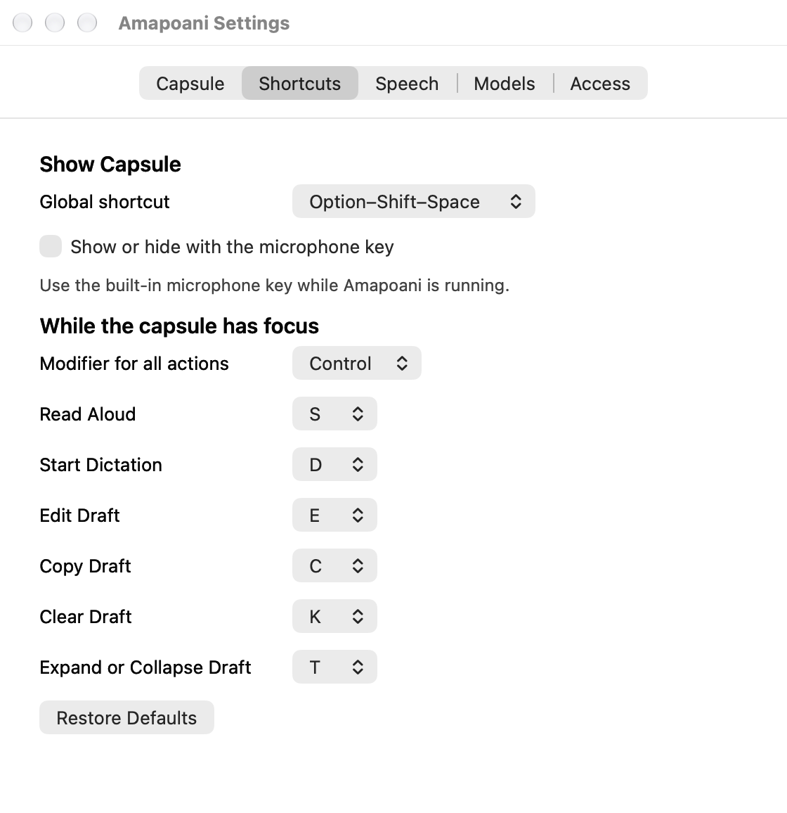

# Microphone-key shortcut

In **Amapoani → Settings → Shortcuts**, enable **Show or hide with the microphone key**. When the status says **Ready**, press the built-in microphone key by itself. It toggles the idle capsule while Amapoani runs. Active playback and recording stay visible. **Fn–F5** retains its function-key behavior.

Amapoani configures the built-in keyboard during setup and when it launches with the option enabled. It restores a mapping it created when you turn the option off or quit normally. The app recognizes an existing matching mapping and leaves its ownership with the tool that set it.

## If setup fails

- **No supported built-in microphone key.** Use the displayed global shortcut. An external keyboard can send F13 once the option is successfully set up on a supported Mac.
- **The keyboard already has a remap.** Amapoani leaves existing remaps intact. If you choose to remove the competing remap in the tool that created it, return to Amapoani and click **Try Again**.
- **macOS didn't apply the change.** Click **Try Again**. If macOS shows a permission prompt, read it and choose whether to allow the keyboard change. The global shortcut remains usable.
- **The key opens Apple Dictation.** Verify Amapoani says **Ready**. Check **System Settings → Keyboard → Dictation** if you also assigned an Apple Dictation shortcut to that key.

Early betas used a separate login helper. This release needs no login helper. If you still have the original `local.amapoani.microphone-key` login item and want to retire it, follow the [historical cleanup instructions](https://github.com/xochilcahua/Amapoani-Beta/blob/5f40827/docs/microphone-key.md). [Apple’s key-remapping reference](https://developer.apple.com/library/archive/technotes/tn2450/)
