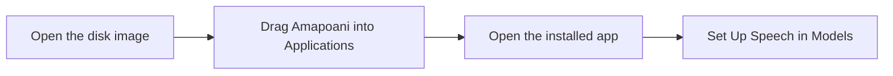
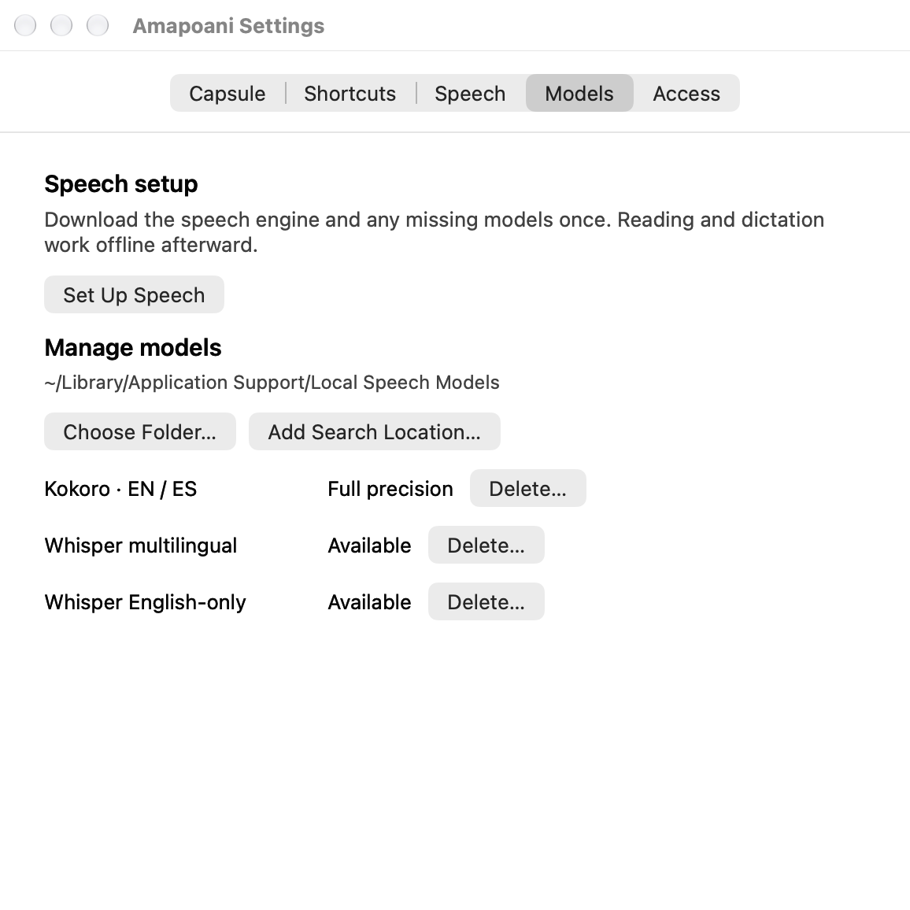
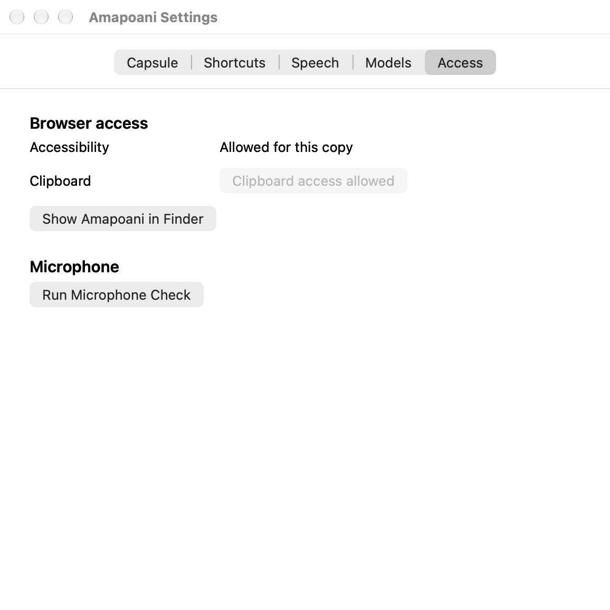

# Install and set up Amapoani

Amapoani runs on Apple Silicon Macs with macOS 14 or later. Internet access is required to download the app, runtime and models. Reading and dictation then run locally.

## Install from the disk image

Download the current `Amapoani-macos-arm64.dmg` from [GitHub Releases](https://github.com/xochilcahua/Amapoani-Beta/releases). Open it and drag **Amapoani** to **Applications**. Eject the disk image and open Amapoani from Applications.

## Approve the first launch

Public beta builds are ad hoc signed. Apple notarization for individual developers requires a paid Developer Program membership. macOS may say it cannot check Amapoani for malicious software.

If you downloaded the beta from the release linked above and choose to approve it, dismiss the first alert. In **System Settings → Privacy & Security**, scroll to **Security** and choose **Open Anyway** next to **Amapoani.app**. Confirm **Open** in Apple's prompt and authenticate if requested. If the button has expired, try opening the installed copy once to bring it back. [Apple’s per-app approval instructions](https://support.apple.com/en-us/102445)

New ad hoc builds can require approval again. A warning that the app is **damaged** or **will damage your computer** is a different message. Use the official release checksum to check the download and report the exact message if it persists.

## Set up speech

When the speech runtime is missing, Amapoani opens Settings directly to **Models**. Choose **Set Up Speech**. The app checks the runtime download and gets the missing models. If Settings is closed, open **Settings** from the Amapoani menu-bar icon, then select **Models**.

- **Kokoro · EN / ES** reads English and Spanish.
- **Whisper multilingual** is the recommended dictation model for both languages. Whisper can recognize other languages in Auto. The beta exposes and tests English and Spanish.
- **Whisper English-only** remains available for older installations that already use it. One Whisper model is sufficient.

The default shared model folder is `~/Library/Application Support/Local Speech Models`. Use **Choose Folder** to change it or **Add Search Location** to reuse a compatible model. The downloaded runtime lives under `~/Library/Application Support/Amapoani/Speech Runtime`.

## Enable browser integration

**Settings → Access** shows the authorization status for the installed app. Use **Allow Access** when macOS blocks selection reading or external dictation. For apps that use clipboard-based insertion, also follow **Set Up Clipboard Access**. This lets Amapoani verify selected text or insert a reviewed transcript where supported. The internal draft remains available for pasting and dictating.

For recording, macOS requests microphone access when you dictate or run the optional microphone check. Set it under **System Settings → Privacy & Security → Microphone** if you declined the prompt.

## Update or remove

Quit Amapoani from its menu-bar icon, then drag the new copy to **Applications** and confirm the replacement. Settings and supported shared models carry over. macOS may ask you to authorize the newly installed copy.

To uninstall, quit Amapoani and move **Amapoani.app** from Applications to Trash. You can also remove `~/Library/Application Support/Amapoani` if you want to delete its downloaded runtime. The shared model folder can contain files used by other apps. Delete individual Amapoani-managed models from **Settings → Models** if you no longer need them.

Next, see the [user guide](guide.md) for the capsule controls.
